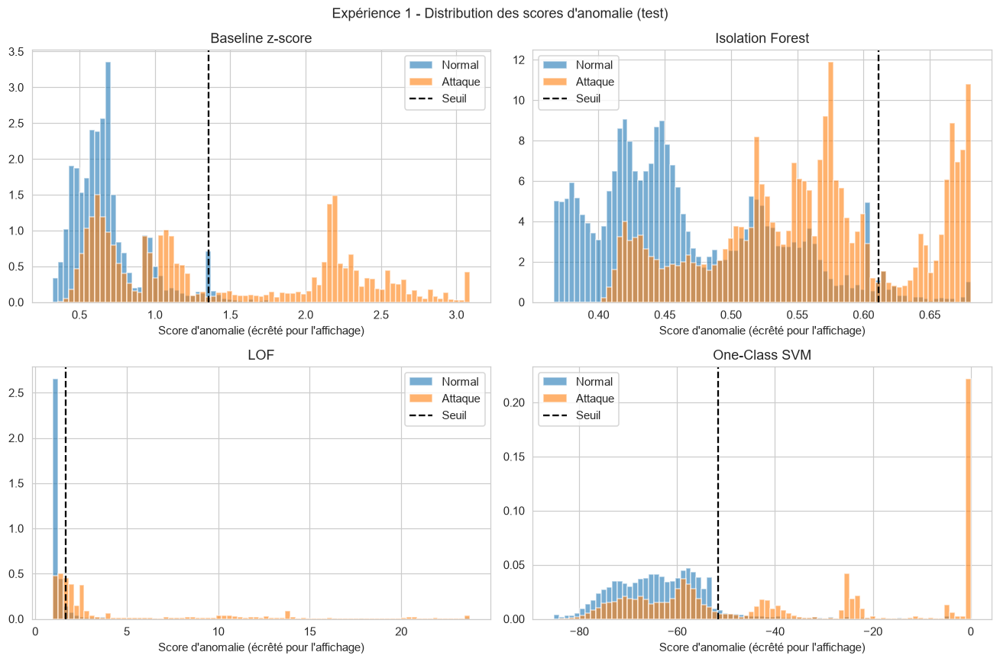
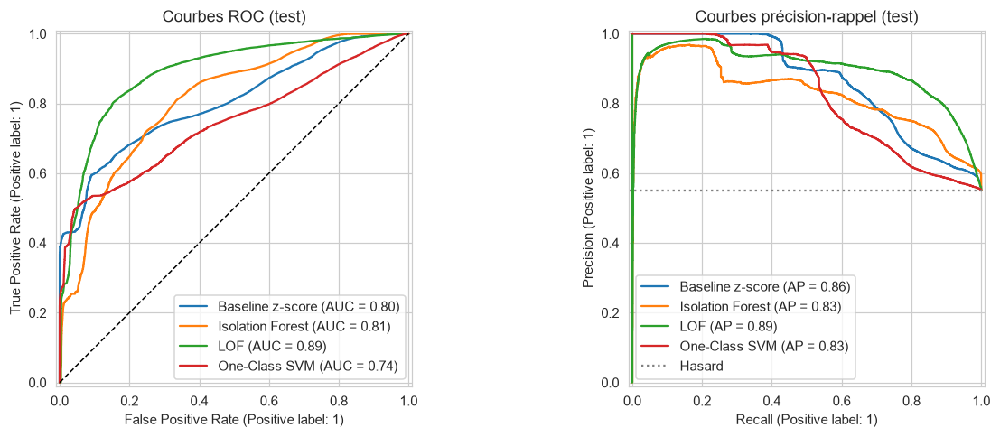
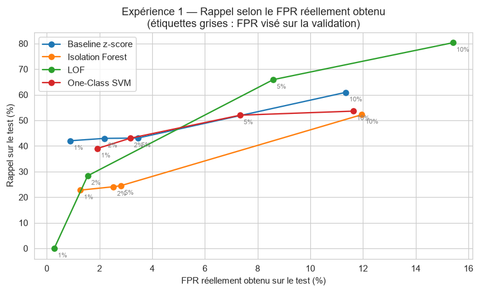
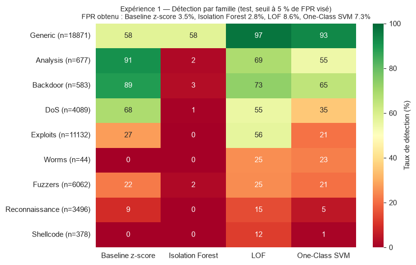

# Expérience 1 — Analyse des résultats

> Analyse de l'exécution du notebook `notebooks/projet5_AntoineMOREL_EtienneSEILLE_DelvinTRAN.ipynb` (section « Phase 3 — Expérience 1 »). Tous les chiffres et figures proviennent de cette exécution (tables et figures dans `notebooks/results/`). Deux figures ont été ajoutées à partir des CSV produits par le notebook (§ 3.3 et § 3.4) ; leur code est donné en annexe pour être repris dans le notebook.

## 1. Rappel du cadre

| Élément | Contenu |
|---|---|
| **Question de recherche** | Des détecteurs appris uniquement sur du trafic normal détectent-ils les attaques, et avec quels compromis entre détection et fausses alertes ? |
| **Hypothèse H1** | Les méthodes auront des compromis différents entre détection et faux positifs. |
| **Critère fixé avant l'expérience** | H1 est soutenue si le classement des modèles par rappel change selon le budget de FPR (1, 2, 5, 10 %), **ou** si l'écart de rappel entre modèles dépasse 5 points au seuil commun. |
| **Protocole** | Baseline z-score, Isolation Forest (200 arbres, 256 flux par arbre), LOF (35 voisins, `novelty=True`), One-Class SVM (RBF, `nu=0.05`, `gamma="scale"`). Tous entraînés sur les **mêmes 20 000 flux normaux** (`X_fit`), même prétraitement, hyperparamètres fixés a priori. Seuil = 95e percentile des scores des **flux normaux de validation** (FPR visé 5 %). Mesures sur le test officiel (82 332 flux, dont 55,1 % d'attaques). |

Rappel utile pour lire les chiffres : avec 55,1 % d'attaques dans le test, un détecteur aléatoire a déjà une **précision de 55,1 %** et une **PR-AUC de 55,1 %**. Les précisions autour de 90 % ci-dessous ne sont donc pas transposables à un vrai réseau (voir § 5).

## 2. Résultats globaux

### 2.1 Au seuil commun (FPR visé 5 % sur la validation)

| Modèle | Précision | Rappel | F1 | Macro-F1 | FPR (test) | ROC-AUC | PR-AUC | Fausses alertes | Attaques manquées |
|---|---:|---:|---:|---:|---:|---:|---:|---:|---:|
| Baseline z-score | 93,9 % | 43,1 % | 59,1 % | 65,8 % | 3,5 % | 80,5 % | 86,4 % | 1 277 | 25 805 |
| Isolation Forest | 91,4 % | **24,5 %** | 38,6 % | 52,9 % | 2,8 % | 81,0 % | 82,6 % | 1 038 | 34 235 |
| **LOF** | 90,4 % | **65,9 %** | **76,2 %** | **77,3 %** | **8,6 %** | **88,9 %** | **89,5 %** | 3 179 | 15 464 |
| One-Class SVM | 89,7 % | 52,0 % | 65,8 % | 69,8 % | 7,3 % | 74,5 % | 82,8 % | 2 714 | 21 753 |

Tous les modèles s'entraînent en moins d'une seconde ; le scoring de la validation et du test prend de 0,2 s (baseline) à 5,5 s (One-Class SVM).

### 2.2 Choix du modèle analysé (sur la validation)

| Modèle | PR-AUC validation | PR-AUC test |
|---|---:|---:|
| Baseline z-score | **92,9 %** | 86,4 % |
| Isolation Forest | 91,3 % | 82,6 % |
| LOF | 91,8 % | **89,5 %** |
| One-Class SVM | 88,5 % | 82,8 % |

LOF est retenu parce qu'il a la meilleure PR-AUC de validation **parmi les trois détecteurs**, conformément au protocole (aucun choix sur le test). Deux remarques :
- l'écart avec Isolation Forest sur la validation est faible (0,5 point), alors qu'il est de 6,9 points sur le test : **le classement de validation ne prédit qu'imparfaitement celui du test** ;
- sur la validation, la baseline a la meilleure PR-AUC de tous les modèles. Validation (68,1 % d'attaques, issue du fichier d'entraînement) et test (55,1 %, fichier séparé) n'ont pas la même composition, ce qui explique une partie de ces écarts.

### 2.3 Distribution des scores d'anomalie



Ce que montre la figure :
- **Baseline** : un groupe d'attaques est très loin du normal (pic vers 2,2), donc facile ; le reste des attaques se superpose au pic normal (0,4–0,8).
- **Isolation Forest** : la majorité des attaques a un score **intermédiaire** (0,50–0,60), mêlé à une partie du trafic normal qui monte jusqu'à 0,60. Le seuil (0,61) laisse passer presque toute cette masse : d'où le rappel de 24,5 %.
- **LOF** : le normal est concentré autour de 1 (densité comparable à celle des voisins) et les attaques s'étalent jusqu'à plus de 20. La séparation est la meilleure, mais une partie des attaques reste collée au pic normal.
- **One-Class SVM** : beaucoup d'attaques sont **toutes au score maximal (0)** : très loin de tous les vecteurs de support, elles reçoivent exactement le même score. Le modèle ne peut plus les classer entre elles, ce qui explique en partie sa ROC-AUC la plus basse (74,5 %).

### 2.4 Courbes ROC et précision-rappel



- LOF domine la courbe ROC dès que l'on accepte environ 5 % de FPR, et a la meilleure PR-AUC (0,89).
- À très faible FPR (moins de 3 %), la **baseline** et le **One-Class SVM** détectent davantage : leurs courbes ROC partent plus haut.
- La courbe précision-rappel de LOF **commence à une précision nulle** : les flux les plus « anormaux » selon LOF sont des flux **normaux**. C'est ce qui produit le rappel de 0 % au budget de 1 % (§ 3).
- Isolation Forest reste sous la baseline à faible FPR, puis la dépasse au-delà d'environ 25 % de FPR : son classement global (ROC-AUC 81 %) est correct, mais inutilisable aux budgets réalistes.

## 3. Compromis détection / fausses alertes (H1)

### 3.1 Rappel selon le budget de FPR

| Modèle | FPR visé 1 % | 2 % | 5 % | 10 % |
|---|---:|---:|---:|---:|
| Baseline z-score | **42,0 %** | 43,0 % | 43,1 % | 60,9 % |
| Isolation Forest | 22,7 % | 24,1 % | 24,5 % | 52,2 % |
| LOF | **0,0 %** | 28,4 % | **65,9 %** | **80,3 %** |
| One-Class SVM | 39,0 % | **43,0 %** | 52,0 % | 53,6 % |

### 3.2 FPR réellement obtenu sur le test

| Modèle | FPR visé 1 % | 2 % | 5 % | 10 % |
|---|---:|---:|---:|---:|
| Baseline z-score | 0,9 % | 2,2 % | 3,5 % | 11,3 % |
| Isolation Forest | 1,3 % | 2,5 % | 2,8 % | 12,0 % |
| LOF | 0,3 % | 1,6 % | **8,6 %** | **15,4 %** |
| One-Class SVM | 1,9 % | 3,2 % | 7,3 % | 11,6 % |

Le seuil est fixé pour obtenir le FPR visé **sur la validation**, mais il ne se transfère pas exactement au test : pour LOF, 5 % visés deviennent **8,6 %** (+72 % de fausses alertes par rapport au budget prévu).

### 3.3 Comparaison à FPR réellement égal

Comme les FPR obtenus diffèrent, comparer les rappels « au seuil commun » avantage les modèles dont le FPR a dérivé vers le haut (LOF, One-Class SVM). La figure suivante place chaque point selon son FPR **réel** :



- **Jusqu'à environ 3–4 % de FPR**, la baseline (42–43 %) et le One-Class SVM (39–43 %) sont les meilleurs ; LOF n'atteint que 28,4 % à 1,6 % de FPR.
- **À partir d'environ 5 % de FPR**, LOF devient nettement le meilleur (65,9 % à 8,6 %, contre 52,0 % pour le One-Class SVM à 7,3 %).
- **Isolation Forest est en dessous des autres sur toute la plage utile.**

### 3.4 Verdict H1

| Critère | Mesure | Résultat |
|---|---|---|
| Le classement change selon le budget de FPR | Meilleur rappel : baseline à 1 %, One-Class SVM à 2 %, LOF à 5 % et 10 % | ✅ |
| Écart de rappel > 5 points au seuil commun | 24,5 % (IF) à 65,9 % (LOF) : 41,4 points | ✅ |

**H1 est soutenue.** Le résultat reste vrai si l'on neutralise l'effet de la dérive du FPR : à FPR réel comparable (environ 3 %), la baseline et le One-Class SVM détectent ~43 % des attaques contre 24,5 % pour Isolation Forest, soit un écart de près de 19 points. Nuance honnête : au budget de 2 %, le « changement » de classement entre baseline et One-Class SVM est une quasi-égalité (43,0 % contre 43,0 %) ; la preuve solide est l'inversion entre le budget strict (baseline en tête, LOF à 0 %) et le budget large (LOF en tête à 80 %).

## 4. Détection par famille d'attaque



| Famille (flux de test) | Baseline | Isolation Forest | LOF | One-Class SVM |
|---|---:|---:|---:|---:|
| Generic (18 871) | 57,6 % | 57,5 % | **97,3 %** | 93,3 % |
| Analysis (677) | **91,3 %** | 2,1 % | 68,5 % | 54,5 % |
| Backdoor (583) | **89,0 %** | 3,1 % | 73,2 % | 65,0 % |
| DoS (4 089) | **68,4 %** | 0,7 % | 55,3 % | 35,5 % |
| Exploits (11 132) | 27,4 % | 0,4 % | **56,5 %** | 21,1 % |
| Worms (44) | 0,0 % | 0,0 % | **25,0 %** | 22,7 % |
| Fuzzers (6 062) | 22,2 % | 2,3 % | **24,8 %** | 20,6 % |
| Reconnaissance (3 496) | 9,0 % | 0,1 % | **14,7 %** | 4,8 % |
| Shellcode (378) | 0,0 % | 0,0 % | **12,2 %** | 0,8 % |
| *Normal = FPR (37 000)* | *3,5 %* | *2,8 %* | *8,6 %* | *7,3 %* |

*Observation.*
- **Aucun modèle ne domine sur toutes les familles.** La baseline est la meilleure sur *Analysis*, *Backdoor* et *DoS* ; LOF sur *Generic*, *Exploits* et les familles difficiles.
- **Isolation Forest ne détecte pratiquement que *Generic*** (57,5 %) ; toutes les autres familles sont sous 4 %.
- **Familles difficiles pour tous** : *Reconnaissance* (≤ 15 %), *Shellcode* (≤ 12 %), *Fuzzers* (≤ 25 %), *Worms* (≤ 25 %, soit 11 flux sur 44).
- Les taux de LOF et du One-Class SVM sont obtenus avec un FPR plus élevé (8,6 % et 7,3 %) : une partie de leur avantage vient de ce seuil plus permissif.

*Aperçu pour l'expérience 3.* Parmi les familles qui seront « inconnues » : *Backdoor* est déjà bien détectée sans aucun exemple (73 à 89 %), alors que *Reconnaissance*, *Shellcode* et *Worms* le sont très mal. C'est la piste principale pour **Q2** (« quelles attaques ressemblent trop au trafic normal ? »).

## 5. Faux positifs et faux négatifs du modèle retenu (LOF)

> Analyse faite sur le test pour **comprendre** les erreurs ; aucun modèle ni seuil n'a été modifié ensuite (usage du test signalé, comme l'exige le sujet).

### 5.1 Quels flux normaux déclenchent des alertes ?

| Service | Flux normaux | Taux de FP | Part des FP |
|---|---:|---:|---:|
| `-` (non identifié) | 27 375 | 8,7 % | 75,1 % |
| http | 4 013 | 10,7 % | 13,5 % |
| **ftp** | 758 | **20,7 %** | 4,9 % |
| dns | 3 068 | 3,1 % | 3,0 % |
| smtp | 635 | 7,2 % | 1,4 % |
| **ssh** | 200 | **13,0 %** | 0,8 % |

| État | Flux normaux | Taux de FP | Part des FP |
|---|---:|---:|---:|
| FIN | 24 172 | 7,1 % | 54,2 % |
| **INT** | 4 485 | **15,4 %** | 21,7 % |
| CON | 6 633 | 7,5 % | 15,6 % |
| **REQ** | 1 707 | **15,5 %** | 8,3 % |

Le service `-` représente 75 % des fausses alertes, mais aussi 74 % des flux normaux : il n'est **pas** sur-représenté. En revanche, les flux normaux **ftp** (20,7 %), **ssh** (13,0 %) et **http** (10,7 %) déclenchent plus souvent une alerte que la moyenne (8,6 %), de même que les connexions **incomplètes** (états `INT` et `REQ`, environ 15 %, deux fois plus que les connexions terminées `FIN`).

### 5.2 Profil des décisions (médianes sur le test)

| Variable | Vrai négatif (normal non signalé) | Faux positif (normal signalé) | Vrai positif (attaque détectée) | Faux négatif (attaque manquée) |
|---|---:|---:|---:|---:|
| `dur` (s) | 0,224 | 0,105 | **0,000** | 0,433 |
| `spkts` / `dpkts` | 10 / 8 | 10 / 8 | **2 / 0** | 10 / 6 |
| `sbytes` / `dbytes` | 978 / 354 | 800 / 354 | **114 / 0** | 664 / 268 |
| `rate` | 107 | 234 | **111 111** | 45 |
| `sttl` / `dttl` | 62 / 29 | 62 / 29 | 254 / 0 | **254 / 252** |
| `ct_srv_src` | 4 | 5 | 12 | 3 |

*Observation.*
- Les **attaques détectées** sont des flux quasi instantanés, à sens unique (2 paquets envoyés, aucun reçu, 0 octet en retour), à débit très élevé et répétés vers le même service.
- Les **attaques manquées** ressemblent à des **sessions normales complètes** (10 paquets envoyés, 6 reçus, quelques centaines d'octets dans chaque sens, une fraction de seconde). La seule différence nette avec le normal est le **TTL** (254 / 252 au lieu de 62 / 29).
- Les **fausses alertes** sont des flux normaux un peu plus courts et plus rapides que la moyenne (débit médian 234 contre 107).

## 6. Analyse

### Observation expérimentale
- Au seuil commun, le rappel va de 24,5 % (Isolation Forest) à 65,9 % (LOF), pour un FPR réel de 2,8 % à 8,6 %.
- **Seul LOF fait mieux que la baseline** en PR-AUC (89,5 % contre 86,4 %). Isolation Forest (82,6 %) et le One-Class SVM (82,8 %) font **moins bien** que le détecteur le plus simple.
- Le meilleur modèle dépend du budget : baseline à moins de 3 % de FPR, LOF au-delà de 5 %.

### Interprétation ML
- **LOF** raisonne localement : un flux est anormal s'il se trouve dans une zone moins dense que ses voisins. Il repère ainsi des attaques qui ne sont extrêmes sur aucune variable prise seule, mais dont la **combinaison** de valeurs n'existe pas dans le normal ; d'où la meilleure séparation globale. Revers : les flux normaux situés dans des zones peu denses (services rares comme ftp ou ssh, connexions incomplètes) obtiennent les scores les plus élevés de tous. Au budget de 1 %, le seuil se place donc au-dessus de toutes les attaques (rappel nul).
- **Isolation Forest** isole un point en coupant au hasard sur **une variable à la fois** : il repère les valeurs extrêmes, pas les combinaisons inhabituelles. Or, après le prétraitement, aucune attaque ne peut dépasser le 99e percentile du trafic normal sur les 22 variables continues (écrêtage appris sur le normal), et les attaques semblent se distinguer surtout par des **combinaisons** de valeurs qui existent séparément dans le normal (TTL de 254 **et** absence de réponse, par exemple) plutôt que par des valeurs record. *Hypothèse à vérifier* : relancer Isolation Forest sans écrêtage pour mesurer cet effet.
- **One-Class SVM** : avec `gamma="scale"`, le noyau RBF donne une similarité quasi nulle à tout point éloigné des vecteurs de support ; ces points reçoivent tous le même score maximal (§ 2.3) et ne peuvent plus être classés entre eux. Les attaques proches du normal restent, elles, à l'intérieur de la frontière.
- **La baseline** profite d'un groupe d'attaques très éloignées du normal sur de nombreuses variables (flux instantanés à sens unique) : elle les détecte même au budget le plus strict, mais rien au-delà de ce groupe.
- **Plus complexe ne veut pas dire meilleur** : deux des trois détecteurs imposés font moins bien que la baseline. Un modèle ne vaut que par l'adéquation entre son principe (extrêmes, densité locale, frontière) et la forme réelle des attaques.

### Interprétation cybersécurité
- **Volume d'alertes.** Pour un réseau de 1 million de flux normaux par jour, le FPR réel donne : 28 000 (Isolation Forest), 34 500 (baseline), 73 000 (One-Class SVM) et **86 000 (LOF)** fausses alertes par jour. Aucune équipe SOC ne peut trier un tel volume.
- **Précision réaliste.** Si les attaques ne représentaient que 1 % du trafic (au lieu de 55 % ici), la précision tomberait à 11,2 % (baseline), 8,1 % (Isolation Forest), 7,2 % (LOF) et 6,7 % (One-Class SVM) : **environ 9 alertes sur 10 seraient fausses** (projection calculée à partir du rappel et du FPR mesurés).
- **Dérive du seuil.** Un seuil réglé sur une période ne garantit pas le volume d'alertes sur une autre (5 % prévus, 8,6 % obtenus pour LOF) : il faut surveiller ce volume et recalibrer régulièrement.
- **Ce qui est détecté** : les flux massifs, automatisés et à sens unique (balayages, inondations, *Generic*). **Ce qui passe** : les attaques qui empruntent une session d'apparence normale (*Exploits*, *Shellcode*, *Fuzzers*), invisibles dans les seules statistiques de flux. Les détecter demanderait d'inspecter le contenu (charge utile, requêtes applicatives).
- **Fausses alertes explicables** : services rares mais légitimes (ftp, ssh) et connexions incomplètes. Une liste blanche ou un réglage par service réduirait ce bruit.
- **Complémentarité** : la baseline est meilleure à budget strict, LOF à budget large. Un SOC pourrait combiner plusieurs détecteurs ou adapter le seuil à sa capacité de traitement.

### Limites
- **Un seul échantillon d'entraînement et une seule graine** : la variabilité des résultats n'est pas mesurée dans cette expérience.
- **Hyperparamètres fixés a priori** : un autre `n_neighbors` (LOF) ou `gamma` (One-Class SVM) pourrait changer le classement. Ce choix est voulu (les optimiser exigerait des attaques étiquetées), mais il limite la portée de la comparaison.
- **Validation et test de compositions différentes** : le seuil et le choix du modèle, faits sur la validation, se transfèrent imparfaitement au test (§ 2.2, § 3.2).
- **Familles rares** : 44 *Worms* et 378 *Shellcode* dans le test ; pour *Worms*, un flux vaut 2,3 points de pourcentage.
- **Artefacts du dataset** : les attaques manquées ne se distinguent du normal que par le TTL, très probablement un artefact du banc de test. Un modèle qui s'appuierait davantage sur le TTL les détecterait, sans que cela se transpose à un vrai réseau (test de robustesse prévu en phase 6).
- **Précision gonflée** par la proportion d'attaques du dataset (55,1 %).
- **Analyse des erreurs faite sur le test**, uniquement pour comprendre (signalé).

## 7. Ce que l'expérience 1 apporte à la problématique

> *Peut-on construire une défense réseau efficace en se basant uniquement sur un comportement normal ?*

| Critère | Ce que montre l'expérience 1 |
|---|---|
| **Détection** | Oui, partiellement : sans aucun exemple d'attaque, on détecte de 25 % à 66 % des attaques au budget visé de 5 %, jusqu'à 80 % en acceptant 15 % de FPR. |
| **Coût** | Non, en l'état : plusieurs dizaines de milliers de fausses alertes par jour, et environ 9 alertes sur 10 fausses à une proportion réaliste d'attaques. |
| **Nouveauté** | Encourageant : *Backdoor*, qui sera « inconnue » dans l'expérience 3, est détectée à 73–89 %. Mais *Reconnaissance*, *Shellcode* et *Worms* le sont très mal. |
| **Robustesse** | Non testée ici (expérience 2). |

**Conclusion provisoire.** Le comportement normal suffit à repérer les attaques **bruyantes** (massives, automatisées, à sens unique), même sans les avoir jamais vues. Il ne suffit pas à construire **seul** une défense efficace : les attaques qui imitent une session normale lui échappent, et le volume de fausses alertes est incompatible avec un SOC. La détection d'anomalies apparaît comme une **couche complémentaire** d'une défense, pas comme une défense à part entière.

## 8. Suites proposées

1. Reporter cette analyse dans la cellule « 3.6 Analyse ✍️ » du notebook et dans le rapport.
2. Ajouter au notebook le code des deux figures de l'annexe, pour que toutes les figures soient produites par le notebook.
3. Vérifications possibles, sans toucher au test : Isolation Forest **sans écrêtage** (hypothèse du § 6) ; résultats sur plusieurs graines d'échantillonnage.
4. Expérience 3 : prévoir que *Backdoor* sera bien détectée par les détecteurs d'anomalies, et *Shellcode* / *Worms* très mal.

## Annexe — Code des deux figures ajoutées

À placer dans le notebook après la cellule « Détection par famille » (utilise `tradeoff`, `fam_exp1`, `DETECTORS` et `save_fig` déjà définis).

```python
# Rappel selon le FPR réellement obtenu sur le test (les FPR obtenus diffèrent du FPR visé)
fig, ax = plt.subplots(figsize=(7.5, 4.6))
for name, g in tradeoff.groupby("modèle", sort=False):
    g = g.sort_values("FPR test")
    ax.plot(g["FPR test"] * 100, g["Rappel test"] * 100, marker="o", label=name)
    for _, r in g.iterrows():
        ax.annotate(f"{r['FPR visé']:.0%}", (r["FPR test"] * 100, r["Rappel test"] * 100),
                    textcoords="offset points", xytext=(4, -10), fontsize=7, color="grey")
ax.set_xlabel("FPR réellement obtenu sur le test (%)"); ax.set_ylabel("Rappel sur le test (%)")
ax.set_title("Rappel selon le FPR réellement obtenu (étiquettes : FPR visé sur la validation)")
ax.legend(); plt.tight_layout(); save_fig(fig, "exp1_rappel_vs_fpr_reel"); plt.show()

# Carte de chaleur des taux de détection par famille
att = fam_exp1.drop(index="Normal")
att = att.loc[att[DETECTORS].max(axis=1).sort_values(ascending=False).index]
fig, ax = plt.subplots(figsize=(8, 5))
sns.heatmap(att[DETECTORS] * 100, annot=True, fmt=".0f", cmap="RdYlGn", vmin=0, vmax=100, ax=ax,
            yticklabels=[f"{i} (n={int(n)})" for i, n in att["flux (test)"].items()],
            cbar_kws={"label": "Taux de détection (%)"})
ax.set_title("Détection par famille (test, seuil à 5 % de FPR visé)"); ax.set_xlabel(""); ax.set_ylabel("")
plt.tight_layout(); save_fig(fig, "exp1_heatmap_familles"); plt.show()
```
