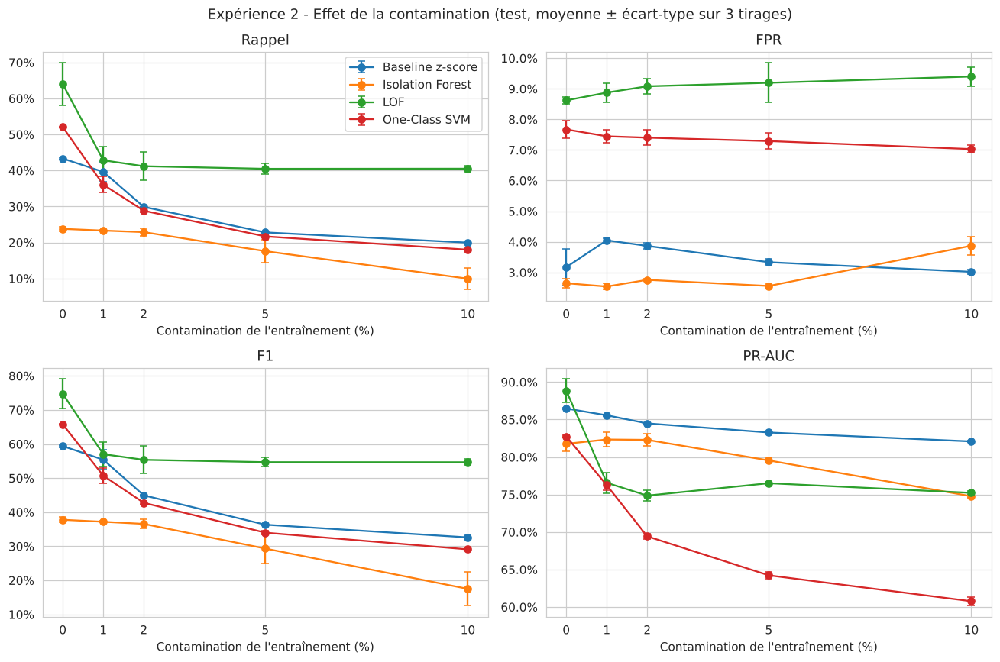
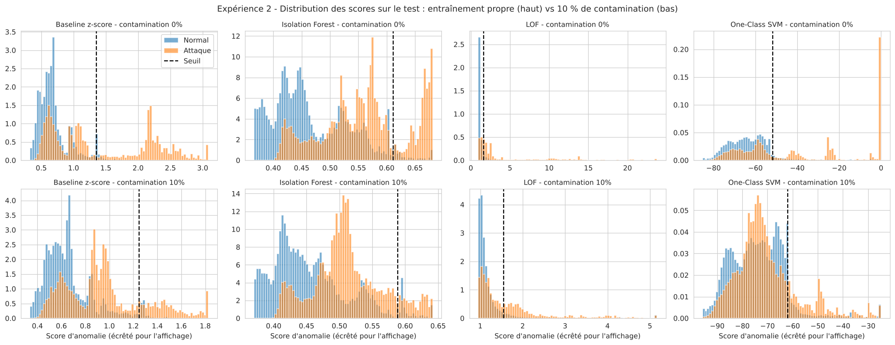

# Expérience 2 — Analyse des résultats

> Analyse de l'exécution du notebook `notebooks/projet5_AntoineMOREL_EtienneSEILLE_DelvinTRAN.ipynb` (section « Phase 4 — Expérience 2 »). Tous les chiffres et figures proviennent de cette exécution (tables et figures dans `notebooks/results/`, préfixe `exp2_`).

## 1. Rappel du cadre

| Élément | Contenu |
|---|---|
| **Question de recherche** | Les détecteurs restent-ils fiables si le trafic « supposé normal » de l'entraînement contient des attaques non repérées ? |
| **Hypothèse H2** | L'augmentation de la contamination réduira la capacité à distinguer normal et attaque. |
| **Critère fixé avant l'expérience** | H2 est soutenue pour un détecteur si sa PR-AUC moyenne est plus basse à 10 % qu'à 0 % **et** que la baisse dépasse l'écart-type entre tirages. Elle est soutenue globalement si c'est le cas pour la majorité des détecteurs. Seuil critique : premier niveau où le rappel moyen perd plus de **5 points** (même seuil de pertinence pratique que pour H1). |
| **Protocole** | Les 4 détecteurs de l'expérience 1, mêmes hyperparamètres, même pipeline. Entraînement de **20 000 flux** à chaque niveau (0, 1, 2, 5, 10 %), en **remplaçant** des flux normaux par des attaques tirées au hasard dans le pool d'attaques (80 % du train officiel). Prétraitement appris sur les données contaminées. Seuil = 95e percentile des scores des **flux normaux propres de validation** (FPR visé 5 %). Mesures sur le test officiel. **3 tirages** par niveau (graines 42, 43, 44) : 60 entraînements. |

**Contrôle de cohérence.** Le niveau 0 % du tirage 1 (graine 42) utilise exactement le même échantillon `X_fit` que l'expérience 1 ; le notebook vérifie qu'il redonne les mêmes rappel, FPR et PR-AUC.

**Composition des jeux contaminés (tirage 1).** Les attaques injectées suivent la répartition du pool :

| Famille injectée | 1 % | 2 % | 5 % | 10 % |
|---|---:|---:|---:|---:|
| Generic | 75 | 143 | 343 | 686 |
| Exploits | 50 | 108 | 277 | 557 |
| Fuzzers | 26 | 55 | 130 | 297 |
| DoS | 23 | 39 | 115 | 209 |
| Reconnaissance | 18 | 39 | 96 | 170 |
| Analysis | 4 | 9 | 19 | 39 |
| Backdoor | 1 | 2 | 9 | 23 |
| Shellcode | 2 | 4 | 10 | 17 |
| Worms | 1 | 1 | 1 | 2 |
| **Total** | **200** | **400** | **1 000** | **2 000** |

## 2. Résultats globaux

### 2.1 Moyenne ± écart-type sur 3 tirages (test, FPR visé 5 %)

| Modèle | Contamination | Rappel | FPR | F1 | PR-AUC |
|---|---:|---:|---:|---:|---:|
| Baseline z-score | 0 % | 43,3 % ± 0,2 | 3,2 % ± 0,6 | 59,4 % ± 0,3 | 86,5 % ± 0,1 |
| | 1 % | 39,6 % ± 2,8 | 4,0 % ± 0,1 | 55,4 % ± 2,9 | **85,6 %** ± 0,1 |
| | 2 % | 29,9 % ± 0,1 | 3,9 % ± 0,1 | 44,9 % ± 0,1 | **84,5 %** ± 0,0 |
| | 5 % | 22,8 % ± 0,2 | 3,3 % ± 0,1 | 36,3 % ± 0,2 | **83,3 %** ± 0,1 |
| | 10 % | 20,0 % ± 0,4 | 3,0 % ± 0,1 | 32,6 % ± 0,6 | **82,1 %** ± 0,1 |
| Isolation Forest | 0 % | 23,8 % ± 0,6 | 2,6 % ± 0,2 | 37,8 % ± 0,7 | 81,8 % ± 1,0 |
| | 1 % | 23,3 % ± 0,2 | 2,5 % ± 0,1 | 37,2 % ± 0,2 | 82,3 % ± 1,0 |
| | 2 % | 22,9 % ± 1,0 | 2,8 % ± 0,0 | 36,6 % ± 1,3 | 82,3 % ± 0,8 |
| | 5 % | 17,6 % ± 3,2 | 2,6 % ± 0,1 | 29,3 % ± 4,4 | 79,5 % ± 0,3 |
| | 10 % | 9,9 % ± 3,0 | 3,9 % ± 0,3 | 17,5 % ± 4,9 | 74,8 % ± 0,2 |
| LOF | 0 % | **64,0 %** ± 5,9 | 8,6 % ± 0,1 | **74,7 %** ± 4,3 | **88,9 %** ± 1,5 |
| | 1 % | **42,8 %** ± 3,7 | 8,9 % ± 0,3 | **57,0 %** ± 3,6 | 76,6 % ± 1,4 |
| | 2 % | **41,2 %** ± 4,0 | 9,1 % ± 0,2 | **55,4 %** ± 4,0 | 74,9 % ± 0,7 |
| | 5 % | **40,5 %** ± 1,5 | 9,2 % ± 0,6 | **54,7 %** ± 1,3 | 76,5 % ± 0,2 |
| | 10 % | **40,5 %** ± 0,9 | 9,4 % ± 0,3 | **54,7 %** ± 0,9 | 75,2 % ± 0,2 |
| One-Class SVM | 0 % | 52,1 % ± 0,1 | 7,7 % ± 0,3 | 65,8 % ± 0,1 | 82,7 % ± 0,2 |
| | 1 % | 36,1 % ± 2,2 | 7,4 % ± 0,2 | 50,7 % ± 2,3 | 76,2 % ± 0,6 |
| | 2 % | 28,8 % ± 0,5 | 7,4 % ± 0,3 | 42,8 % ± 0,5 | 69,4 % ± 0,4 |
| | 5 % | 21,7 % ± 0,4 | 7,3 % ± 0,3 | 34,0 % ± 0,6 | 64,2 % ± 0,5 |
| | 10 % | 18,0 % ± 0,2 | 7,0 % ± 0,1 | 29,1 % ± 0,3 | 60,8 % ± 0,6 |

ROC-AUC moyenne à 0 % puis 10 % : baseline 80,6 → 78,5 % ; Isolation Forest 80,9 → 77,4 % ; LOF 88,0 → 72,8 % ; One-Class SVM 74,4 → 55,0 %.

### 2.2 Courbes contamination → rappel, FPR, F1, PR-AUC

- **One-Class SVM** se dégrade le plus, et de façon continue : PR-AUC de 82,7 % à 60,8 %, ROC-AUC de 74,4 % à 55,0 % (presque le hasard).
- **LOF** chute **brutalement dès 1 %** (rappel 64,0 → 42,8 %, PR-AUC 88,9 → 76,6 %), puis se **stabilise** : l'essentiel des dégâts est fait par les 200 premières attaques.
- **Baseline** : PR-AUC presque stable (−4,4 points), mais rappel divisé par deux (43,3 → 20,0 %).
- **Isolation Forest** résiste jusqu'à 2 %, puis décroche (rappel 23,8 → 9,9 % à 10 %).
- **FPR stable** pour tous (2,5 à 9,4 %) : le seuil étant fixé sur du trafic propre, la contamination dégrade la **détection**, pas le volume de fausses alertes. Seule exception : Isolation Forest à 10 % (3,9 %).

### 2.3 Variabilité entre tirages (apport à l'expérience 1)

À 0 %, les trois tirages ne diffèrent que par l'échantillon de 20 000 flux normaux :

| Modèle | Rappel (graines 42 / 43 / 44) | PR-AUC (42 / 43 / 44) |
|---|---|---|
| Baseline z-score | 43,1 / 43,3 / 43,5 % | 86,4 / 86,6 / 86,4 % |
| Isolation Forest | 24,5 / 23,4 / 23,5 % | 82,6 / 80,7 / 82,1 % |
| LOF | 65,9 / **57,4** / 68,7 % | 89,5 / 87,1 / 90,0 % |
| One-Class SVM | 52,0 / 52,1 / 52,1 % | 82,8 / 82,9 / 82,5 % |

Le classement de l'expérience 1 est confirmé (LOF devant la baseline en PR-AUC sur les 3 tirages), mais **le rappel de LOF dépend fortement de l'échantillon** (de 57,4 % à 68,7 %). Cette variabilité, non mesurée dans l'expérience 1, est une limite à y ajouter.

## 3. Évolution des distributions de scores

*Tirage 1, test. En haut : entraînement propre ; en bas : 10 % de contamination.*

- **Baseline** : les attaques ne disparaissent pas, elles **se rapprochent du normal**. Le groupe lointain (2,0–3,0 à 0 %) est ramené vers 1,2–1,8, et le groupe 0,9–1,1 passe sous le seuil. Les attaques injectées **gonflent les écarts-types** appris, ce qui réduit tous les z-scores.
- **One-Class SVM** : le pic d'attaques au score maximal (0) **disparaît**. La frontière s'élargit pour englober les attaques injectées : celles du test se retrouvent à l'intérieur, mêlées au trafic normal.
- **LOF** : les attaques se resserrent contre le pic normal (la plupart sous 2,5, au lieu de 1 à plus de 20) : elles ont désormais des **voisins** dans l'entraînement.
- **Isolation Forest** : la masse d'attaques se décale vers le trafic normal (autour de 0,50 au lieu de 0,55–0,60).

## 4. Verdict H2 et seuil critique

| Modèle | PR-AUC 0 % | PR-AUC 10 % | Baisse | Écart-type max | H2 | Seuil critique (rappel −5 pts) |
|---|---:|---:|---:|---:|:---:|:---:|
| Baseline z-score | 86,5 % | 82,1 % | 4,4 pts | 0,1 pt | ✅ | 2 % |
| Isolation Forest | 81,8 % | 74,8 % | 7,0 pts | 1,0 pt | ✅ | 5 % |
| LOF | 88,9 % | 75,2 % | 13,6 pts | 1,5 pt | ✅ | **1 %** |
| One-Class SVM | 82,7 % | 60,8 % | **22,0 pts** | 0,6 pt | ✅ | **1 %** |

**H2 est soutenue pour les 4 détecteurs** : chaque baisse dépasse largement l'écart-type entre tirages.

Nuance honnête : la baisse n'est pas toujours régulière. Isolation Forest gagne 0,5 point de PR-AUC entre 0 et 2 % (dans la marge d'erreur), et LOF remonte légèrement entre 2 et 5 %. La dégradation est nette **entre 0 et 10 %**, pas à chaque palier.

**Le classement s'inverse** : à 0 %, LOF a la meilleure PR-AUC ; **dès 1 %, c'est la baseline** (85,6 % contre 76,6 % pour LOF). En rappel, LOF reste devant à tous les niveaux (40–43 %), mais avec un FPR de 9 % contre 3–4 % pour la baseline.

## 5. Détection par famille : 0 % vs 10 %

*Moyenne des 3 tirages, test. Écart en points.*

| Famille (flux de test) | Baseline 0 → 10 % | Isolation Forest | LOF | One-Class SVM |
|---|---|---|---|---|
| Generic (18 871) | 57,8 → 46,9 (−10,9) | 56,0 → 22,2 (−33,7) | 93,2 → 61,9 (−31,3) | 93,4 → 35,7 (**−57,7**) |
| Backdoor (583) | 89,5 → 0,9 (**−88,6**) | 2,6 → 1,4 | 74,3 → 53,3 (−20,9) | 65,0 → 3,8 (−61,2) |
| Analysis (677) | 91,3 → 0,0 (**−91,3**) | 1,5 → 0,4 | 70,9 → 53,1 (−17,8) | 54,5 → 0,6 (−53,9) |
| Exploits (11 132) | 27,8 → 0,9 (−26,9) | 0,3 → 1,2 | 55,2 → 24,9 (−30,2) | 20,7 → 6,2 (−14,5) |
| DoS (4 089) | 69,2 → 1,4 (**−67,8**) | 0,6 → 2,1 | 55,7 → 33,7 (−22,0) | 35,6 → 6,5 (−29,0) |
| Fuzzers (6 062) | 22,3 → 0,4 (−21,9) | 2,2 → 0,9 | 24,6 → 22,8 (−1,8) | 21,1 → 6,2 (−14,8) |
| Reconnaissance (3 496) | 9,2 → 0,5 | 0,1 → 0,6 | 15,0 → 11,5 | 4,9 → 1,4 |
| Shellcode (378) | 0,0 → 0,0 | 0,0 → 0,0 | 11,6 → 14,2 (+2,6) | 0,9 → 0,6 |
| Worms (44) | 0,0 → 0,0 | 0,0 → 3,0 | 25,0 → 22,0 | 22,7 → 18,2 |
| *Normal = FPR (37 000)* | *3,2 → 3,0* | *2,6 → 3,9* | *8,6 → 9,4* | *7,7 → 7,0* |

*Observation.*
- **Les familles les plus injectées perdent le plus** : *Generic* (686 flux injectés à 10 %), *Exploits* (557), *DoS* (209). Le détecteur a appris ces attaques comme normales.
- **Les familles presque absentes de l'injection ne bougent pas** : *Shellcode* (17 flux) et *Worms* (2 flux).
- *Backdoor* et *Analysis*, peu injectées (23 et 39 flux), s'effondrent pourtant pour la baseline et le One-Class SVM. *Hypothèse* : leurs flux ressemblent à ceux des familles massivement injectées (*DoS*, *Exploits*) et profitent de leur apprentissage ; à vérifier en comparant leurs profils.
- **La baseline ne détecte plus que *Generic*** (46,9 %) ; tout le reste tombe sous 1,5 %.
- **LOF garde la meilleure couverture** à 10 % : plus de 50 % sur *Generic*, *Backdoor* et *Analysis*.

## 6. Analyse

### Observation expérimentale
- **H2 est soutenue pour les 4 détecteurs** : la PR-AUC baisse de 4,4 (baseline) à 22,0 points (One-Class SVM) entre 0 et 10 % de contamination.
- **1 % de contamination suffit** à faire perdre plus de 5 points de rappel à LOF (−21) et au One-Class SVM (−16).
- Les deux détecteurs les plus performants sur un entraînement propre sont **les plus fragiles** ; la baseline devient la meilleure en PR-AUC dès 1 %.
- Le FPR reste stable : la contamination rend les détecteurs **aveugles**, pas plus bavards.

### Interprétation ML
- **LOF** juge un flux anormal s'il est moins entouré que ses voisins. Une poignée d'attaques similaires dans l'entraînement suffit à créer une petite zone dense : les attaques du test qui leur ressemblent ont désormais des voisins et ne paraissent plus isolées. L'effet sature vite (plateau après 1 %) : une fois la zone créée, ajouter des attaques n'y change plus grand-chose.
- **One-Class SVM** trace une frontière autour de **tout** l'entraînement (avec `nu=0.05`, au plus 5 % des points laissés dehors). Les attaques injectées sont englobées et la frontière s'étire vers elles : c'est la dégradation la plus forte et la plus régulière.
- **Baseline** : la moyenne et surtout l'écart-type sont calculés sur des données contaminées. Des écarts-types gonflés réduisent tous les z-scores : le **classement** des flux change peu (PR-AUC stable), mais avec un seuil fixé sur du trafic propre, beaucoup moins d'attaques le dépassent (rappel divisé par deux).
- **Isolation Forest** ne construit chaque arbre que sur 256 flux : à 1–2 %, chaque arbre ne voit que 2 à 5 attaques, ce qui l'affecte peu. À 5–10 % (13 à 26 attaques par arbre), les attaques ne sont plus faciles à isoler.
- **Effet par famille** : un détecteur « apprend » surtout les familles injectées en nombre et celles qui leur ressemblent ; les familles rares de l'injection restent détectées comme avant.

### Interprétation cybersécurité
- **Un attaquant présent pendant la période d'apprentissage devient invisible.** 200 flux d'attaque sur 20 000 (1 %) suffisent à faire perdre un tiers de ses détections à LOF. C'est le scénario d'une **compromission persistante** : un réseau déjà infecté au moment où l'on « apprend le normal » produit un détecteur qui considère l'infection comme normale.
- **Plus une attaque est répétée, mieux elle est apprise** : les attaques automatisées et massives (*Generic*, *DoS*), les plus faciles à détecter dans l'expérience 1, sont aussi les premières à disparaître.
- **Le volume d'alertes ne signale pas le problème** : le FPR ne bouge pas, rien n'alerte l'équipe SOC de la dégradation.
- **Recommandations** : nettoyer le trafic de référence avant l'apprentissage (par exemple avec les signatures connues ou un second détecteur), réentraîner régulièrement sur des périodes différentes, surveiller la stabilité des scores, et préférer un détecteur robuste (la baseline ou Isolation Forest à faible contamination) quand la propreté des données n'est pas garantie.
- **Le choix du détecteur dépend de la confiance dans les données** : avec un trafic de référence certifié propre, LOF est le meilleur ; avec un trafic douteux, il perd son avantage.

### Limites
- **Contamination tirée au hasard sur toutes les familles**, proportionnellement au pool : une vraie contamination serait plutôt concentrée sur un seul attaquant et une seule famille.
- **Attaques injectées et attaques du test issues des mêmes familles et du même banc de test** : cela maximise l'effet mesuré.
- **Seuil fixé sur une validation propre** : en réalité, la validation serait aussi contaminée, ce qui modifierait le seuil.
- **3 tirages seulement** ; les écarts-types restent indicatifs.
- **Hyperparamètres inchangés** : avec `nu` plus grand, le One-Class SVM laisserait plus de points hors de la frontière et pourrait mieux résister.
- **Petites différences numériques entre machines** : sur LOF, l'exécution peut différer de quelques flux (par exemple 3 179 ou 3 183 fausses alertes au niveau 0 %), à cause d'égalités de distances. Les conclusions n'en dépendent pas, et le contrôle de cohérence compare toujours deux résultats de la même exécution.

## 7. Ce que l'expérience 2 apporte à la problématique

> *Peut-on construire une défense réseau efficace en se basant uniquement sur un comportement normal ?*

| Critère | Ce que montre l'expérience 2 |
|---|---|
| **Détection** | La détection mesurée dans l'expérience 1 suppose un trafic de référence **parfaitement propre**. Dès 1 % d'attaques cachées, LOF et le One-Class SVM perdent un tiers de leur rappel. |
| **Coût** | Inchangé : la contamination ne crée pas plus de fausses alertes. |
| **Nouveauté** | Les familles absentes de la contamination restent détectées comme avant : c'est encourageant pour les attaques réellement nouvelles (expérience 3). |
| **Robustesse** | Faible pour les meilleurs détecteurs ; meilleure pour les plus simples. |

**Conclusion provisoire.** Une défense fondée uniquement sur le comportement normal n'est efficace que si ce comportement normal est **vraiment normal**. Or c'est précisément ce qu'on ne peut pas garantir dans un réseau déjà compromis. La qualité du trafic de référence devient un point critique : sans procédure de nettoyage et de réentraînement, le détecteur apprend à ignorer les attaques qu'il aurait dû signaler.

## 8. Suites proposées

1. Expérience 3 : les familles « inconnues » ne sont pas concernées par la contamination ; vérifier qu'elles restent détectées comme dans l'expérience 1.
2. Variante plus réaliste : contamination par **une seule famille** (par exemple *DoS* seul) pour simuler un attaquant unique.
3. Tester la robustesse du One-Class SVM avec un `nu` plus élevé, et un nettoyage de l'entraînement par un premier détecteur (retirer les flux les plus anormaux avant de réentraîner).
